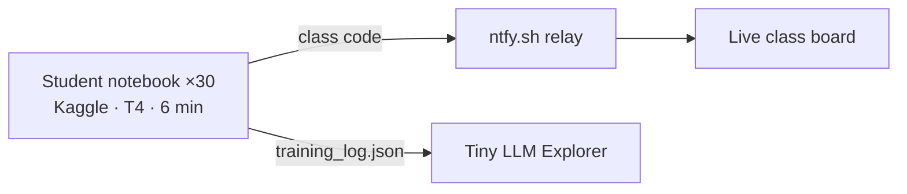

# Train Your Own Mini-LLM

A one-period (50-minute) high-school lesson. Every student trains their own GPT-style language model on a free Kaggle GPU and watches it go from gibberish to Shakespeare in 6 minutes, live.

| | |
|---|---|
| **[Teacher guide + live class board](https://benski20.github.io/LLM-Training/)** | Setup, lesson plan, diagrams. Students' training streams in live. (`index.html`) |
| **[Tiny LLM Explorer](https://benski20.github.io/LLM-Training/dashboard/)** | 7 projector demos, plus replay of a student's run (`dashboard/index.html`) |
| [Notebook](notebooks/train_your_own_llm.ipynb) | Kaggle or Colab. Time-limited training with a live in-notebook dashboard. |
| [Student handout](STUDENT_HANDOUT.md) · [Short teacher guide](TEACHER_GUIDE.md) | One-pagers |

The links above work once GitHub Pages is on: **Settings → Pages → Deploy from branch → `main` / root**.

## Repo layout
- `notebooks/`: the student notebook, generated by `tools/build_notebook.py`
- `index.html`: teacher guide and live class board
- `dashboard/`: Explorer (`index.html` is built from `explorer_src.html` by `tools/build_explorer.py`)
- `data/`: `shakespeare.txt` (Karpathy's char-rnn), `names.txt` (makemore), `sherlock.txt` (Project Gutenberg), `python_code.txt` (Python stdlib, PSF license)
- `checkpoints/shakespeare_pretrained.pt`: backup model for students whose training fails
- `tools/kaggle_publish.py`: optional, publishes the notebook to your Kaggle profile

The model and training loop are adapted from Andrej Karpathy's [nanoGPT](https://github.com/karpathy/nanoGPT).
