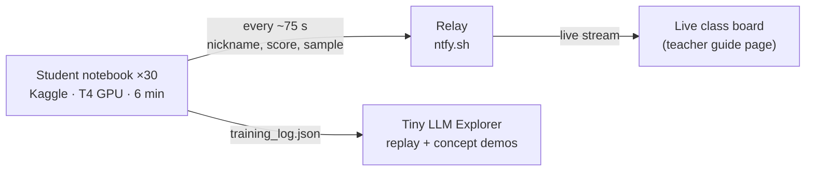
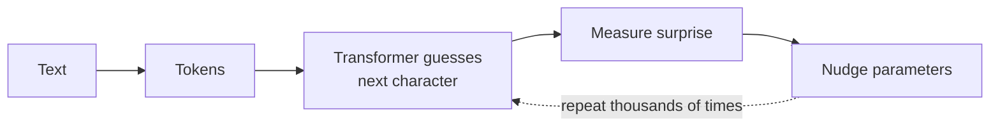

# Teacher Guide

> The full guide, with diagrams and the **live class board**, is the web page at
> **https://benski20.github.io/LLM-Training/** (the same page is `index.html` in this repo). This file is the short version.

## How it works

- **Notebook** (`notebooks/train_your_own_llm.ipynb`): trains a ~5M-parameter character-level GPT (from Karpathy's nanoGPT) for exactly `TRAIN_MINUTES` (6), with a live dashboard inside the notebook.
- **Class board** (teacher guide page): students who type your class code show up live, with one curve per student, a ranking and their latest writing.
- **Explorer** (`dashboard/`): 7 projector demos: tokens, next-letter game, memory, temperature, attention, replay, scale.

## Setup (about 30 minutes, a few days before)

1. **Homework for students:** create a Kaggle account and verify a phone number (*Settings → Phone verification*). This unlocks the GPU and internet. Kaggle requires users to be 13+.
2. **Dry run:** open the notebook in Kaggle →
   `https://kaggle.com/kernels/welcome?src=https://github.com/benski20/LLM-Training/blob/main/notebooks/train_your_own_llm.ipynb`
   → *Session options → Accelerator → GPU T4 x2* → set a test `CLASS_CODE` → **Run All**. Check for `✅ GPU is on: Tesla T4`, your line on the board, and Shakespeare-like samples after 6 minutes.
3. **Pick a class code** on the board page (*New code*).
4. **Share** the Kaggle link and the Explorer link.

Optional: `python tools/kaggle_publish.py` publishes the notebook to your Kaggle profile, so students can *Copy & Edit* it instead.

## Lesson plan

| Min | | Where |
|---|---|---|
| 0–3 | **Hook.** "ChatGPT only guesses the next piece of text." Play the guessing game. | Explorer · 2 |
| 3–8 | **Launch.** Open link → GPU T4 x2 → class code + nickname → Run All. | Kaggle |
| 8–14 | **Watch it learn** on the class board. Confusion falls from ~65 to ~5, and gibberish turns into words. | Board |
| 14–24 | **Concepts.** Tokens, memory, attention. | Explorer · 1, 3, 5 |
| 24–38 | **Play.** Prompts, temperature, slow-motion writing, challenges. | Notebook · Explorer 4 |
| 38–44 | **Show and tell.** Leaders read their best line. Optionally replay a log. | Board · Explorer 6 |
| 44–50 | **Debrief.** Tiny vs. giant. Why can't it answer questions? Bias in the training data. | Explorer 7 |

## The training loop

## Settings

| Setting | Default | |
|---|---|---|
| `TRAIN_MINUTES` | `6` | Time-limited, so it always fits the period. |
| `MODEL_SIZE` | `"medium"` | `small` 0.8M · `medium` 4.8M · `large` 10.7M params |
| `DATASET` | `"shakespeare"` | `sherlock`, `names`, `python_code`, or any `.txt` path |
| `CLASS_CODE` | `""` | Empty means nothing is sent. |
| `NICKNAME` | `"anonymous"` | Shown on the board. |

## Fixes

| Symptom | Fix |
|---|---|
| No working GPU found | Accelerator → **GPU T4 x2** (not P100), then Run All. Greyed out means the account isn't verified: pair up, or use Colab. |
| Data download error | Turn Internet on in Session options (needs a verified phone). |
| Student missing from the board | Check the code spelling and that Internet is on. Training works regardless. |
| Out of time | Bottom cell: uncomment `load_pretrained()` to load the ready-made model. |

**About the relay:** ntfy.sh is free and public. Anyone with the code can read or post, so use generated codes and nicknames. It also limits posts per internet address. If many students share one address, some may show up late or not at all, but their training is unaffected.
